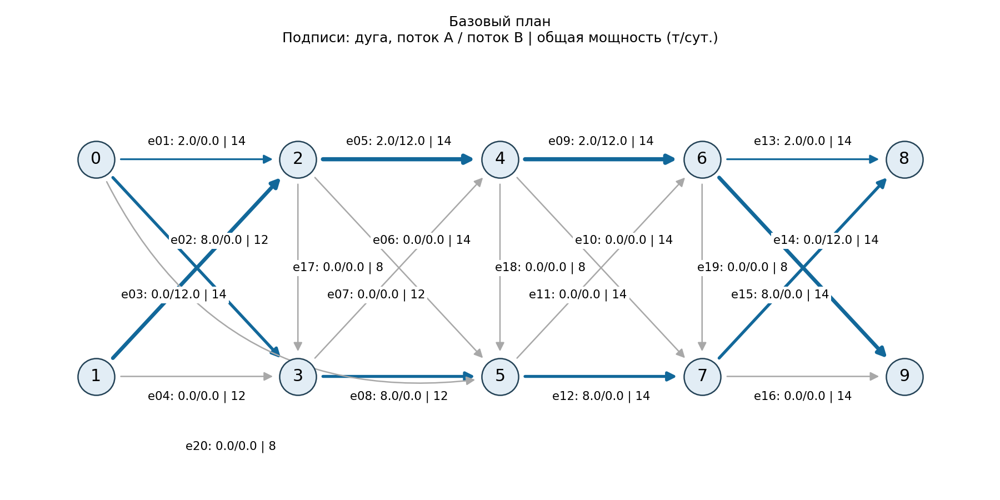
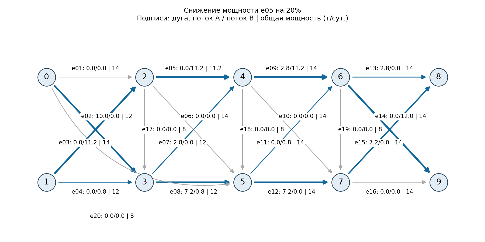
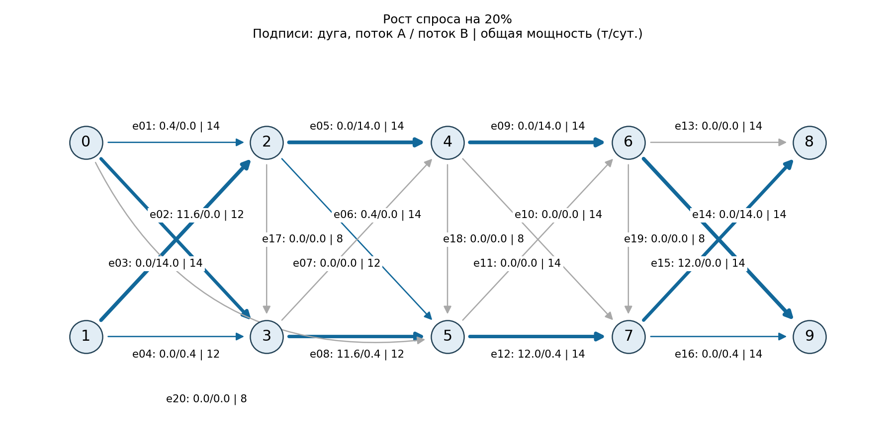
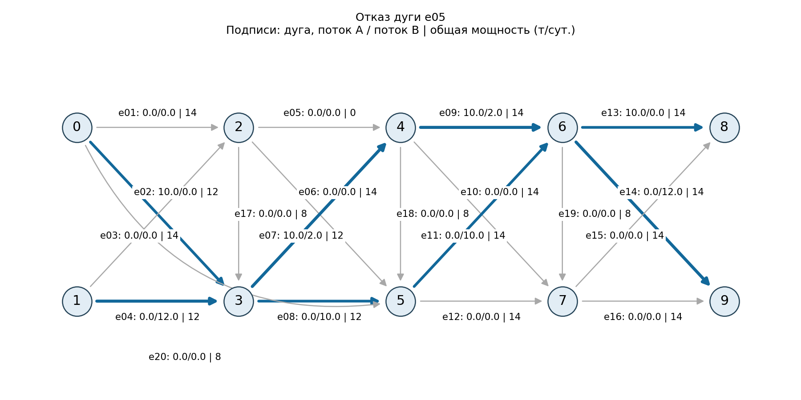

# Лабораторная работа № 2
## Мультитоварный поток в транспортной сети

Дисциплина «Методы оптимизации. Линейное программирование»

Группа 507, Демидович В.А., вариант 9.

## 1 Постановка и данные

Требуется перевезти два груза через сеть с общей пропускной способностью дуг и минимальными затратами. Сеть содержит 10 вершин (0–9) и 20 направленных дуг. Груз A доставляется из узла 0 в узел 8 в объёме 10 т/сут., груз B — из 1 в 9 в объёме 12 т/сут. Узлы 2–7 служат для транзита.

V = 1 + ((17 · 6 + 7 · 0 + 26) mod 20) = 9; seed = 10000 + 100 · 0 + 6 = 10006. Топология, мощности и базовые тарифы заданы в generate_data.py. Для каждого груза тариф каждой дуги умножен на независимое случайное число от 0.8 до 1.2 и округлён до сотых. Генератор — numpy.random.default_rng(10006). Полученные данные сохранены в CSV и JSON отдельно от кода модели.

Мощности измеряются в т/сут., тарифы — в условных денежных единицах за тонну. Стоимость решения имеет единицы усл. ден. ед./сут. Данные синтетические; тарифы двух грузов различаются.

| Дуга | Узлы | Мощность | Тариф A | Тариф B |
|---|---|---:|---:|---:|
| e01 | 0 → 2 | 14 | 1.71 | 2.17 |
| e02 | 0 → 3 | 12 | 2.9 | 3.29 |
| e03 | 1 → 2 | 14 | 1.96 | 1.78 |
| e04 | 1 → 3 | 12 | 2.99 | 2.93 |
| e05 | 2 → 4 | 14 | 1.18 | 1.11 |
| e06 | 2 → 5 | 14 | 4.69 | 4.09 |
| e07 | 3 → 4 | 12 | 2.59 | 3.27 |
| e08 | 3 → 5 | 12 | 2.24 | 1.78 |
| e09 | 4 → 6 | 14 | 1.12 | 1.01 |
| e10 | 4 → 7 | 14 | 3.28 | 3.9 |
| e11 | 5 → 6 | 14 | 2.94 | 2.96 |
| e12 | 5 → 7 | 14 | 1.61 | 1.96 |
| e13 | 6 → 8 | 14 | 2.26 | 2.19 |
| e14 | 6 → 9 | 14 | 2.14 | 2.19 |
| e15 | 7 → 8 | 14 | 3.01 | 3.12 |
| e16 | 7 → 9 | 14 | 2.86 | 3.48 |
| e17 | 2 → 3 | 8 | 1.72 | 2.37 |
| e18 | 4 → 5 | 8 | 2.08 | 2.09 |
| e19 | 6 → 7 | 8 | 2.32 | 2.33 |
| e20 | 0 → 5 | 8 | 9.06 | 8.74 |

<!--pagebreak-->

## 2 Линейная модель

Множества: V — вершины сети; E — направленные дуги; K = {A, B} — грузы. Для груза k заданы источник s_k, получатель t_k и объём q_k, т/сут. Для дуги e заданы общая мощность u_e, т/сут., и тариф c_ke, усл. ден. ед./т.

Переменная x_ke ≥ 0 — поток груза k по дуге e, т/сут. Все переменные непрерывные.

Минимизировать общую суточную стоимость:

Z = sum_k sum_e c_ke · x_ke → min.

Для каждого груза k и узла v выполняется баланс:

sum_(e выходит из v) x_ke − sum_(e входит в v) x_ke = b_kv,

где b_kv = q_k в источнике, −q_k у получателя и 0 в остальных узлах.

Пропускная способность общая для грузов:

x_Ae + x_Be ≤ u_e для каждой дуги e.

Дополнительно x_ke ≥ 0 для всех k и e. Модель содержит 40 переменных, 20 балансовых равенств и 20 ограничений мощности. По одному балансовому равенству для каждого груза линейно зависимы от остальных; presolve может исключить их.

Грузы делимы, каждый может идти по нескольким маршрутам. Потери, время доставки, фиксированные затраты и хранение не учитываются. Тарифы постоянны, а одна тонна любого груза занимает одинаковую долю мощности. Поэтому модель линейная. Два независимых расчёта по грузам не подходят: они могли бы одновременно использовать одну и ту же свободную мощность.

## 3 Реализация и проверка

Решатель — HiGHS 1.12.0 через scipy.optimize.linprog. Выбран highs-ds, то есть двойственный симплекс-метод, presolve включён. Допуски прямой и двойственной допустимости — 1e-7. Использованы Python 3.13.3, NumPy 2.3.5, SciPy 1.18.1 и Matplotlib 3.10.8.

Программа запускается командой python main.py. Данные загружаются из CSV и JSON; после расчёта сохраняются потоки, проверки и схемы сети.

Проверка verify не обращается к объекту солвера и не использует матрицы построенной ЛП. По исходной таблице дуг она заново суммирует входящий и исходящий поток каждого груза в каждой вершине. По каждой дуге отдельно проверяются сумма потоков и её мощность, по всем переменным — неотрицательность. Стоимость пересчитывается по исходным тарифам. Допуск равен 1e-7. Результаты сохраняются в *_balances.csv, *_flows.csv и *_summary.json.

<!--pagebreak-->

## 4 Сценарные эксперименты

Помимо базового расчёта выполнены три эксперимента. Для изменения мощности и отказа выбрана самая загруженная дуга базового плана по суммарному потоку грузов. У e05 и e09 поток одинаков — 14 т/сут.; при равенстве выбирается меньший номер, то есть e05 (2 → 4).

| Сценарий | Изменение | Стоимость | Рост к базе |
|---|---|---:|---:|
| Базовый | Исходная сеть | 163.700 | 0.00% |
| Дефицит мощности | e05: 14 → 11.2 т/сут. | 171.204 | 4.58% |
| Рост спроса | A: 12; B: 14.4 т/сут. | 206.944 | 26.42% |
| Отказ дуги | e05: мощность 0 | 206.100 | 25.90% |

Все четыре расчёта завершены со статусом optimal. Спрос удовлетворён полностью, баланс и ограничения мощности выполнены. В отчёте затраты указаны в усл. ден. ед./сут.

Базовый план можно записать тремя маршрутами:

| Груз | Маршрут | Объём, т/сут. |
|---|---|---:|
| A | 0 → 2 → 4 → 6 → 8 | 2 |
| A | 0 → 3 → 5 → 7 → 8 | 8 |
| B | 1 → 2 → 4 → 6 → 9 | 12 |

Таким образом, 2 т груза A и все 12 т груза B используют общий участок 2 → 4 → 6. Остальные 8 т груза A проходят по нижней ветви. Полные потоки сохранены в *_flows.csv. Схемы четырёх сценариев приведены в приложении.

Снижение мощности e05 на 20% заставляет часть перевозок уйти на более дорогие пути, но не нарушает связность. Стоимость возрастает на 7.504, или 4.58%.

Рост спроса на 20% увеличивает объём с 22 до 26.4 т/сут. Стоимость растёт на 26.42%, то есть быстрее объёма. Причина — ограниченная ёмкость дешёвых маршрутов: дополнительный поток приходится распределять по менее выгодным участкам.

В стрессовом сценарии e05 закрыта полностью. Стоимость увеличивается на 42.4, или 25.90%. Груз A идёт по пути 0 → 3 → 4 → 6 → 8, 10 т/сут. Груз B делится: 2 т/сут. идут по 1 → 3 → 4 → 6 → 9 и 10 т/сут. — по 1 → 3 → 5 → 6 → 9. Сеть сохраняет возможность доставить оба груза, но резервные маршруты обходятся дороже.

<!--pagebreak-->

## 5 Узкие места и двойственные оценки

В базе насыщены e05 (2 → 4) и e09 (4 → 6): по каждой проходит 14 т/сут. при мощности 14. Теневые цены, выданные солвером для этих ограничений, равны −2.60 и −0.89 усл. ден. ед./т. Отрицательный знак означает возможность уменьшить затраты при расширении мощности.

Цена относится к правой части ограничения суммы двух грузов. Она не является отдельной ценой для груза A или B. У ненасыщенных дуг в базовом решении оценки равны нулю.

Для проверки каждая насыщенная дуга расширена отдельно на 0.001 т/сут. Результаты сохранены в *_sensitivity.csv.

| Дуга базы | Прогноз по цене | Фактическое изменение |
|---|---:|---:|
| e05 | −0.002600 | −0.000580 |
| e09 | −0.000890 | −0.000890 |

Для e09 прогноз совпадает с расчётом, для e05 — нет. Участки e05 и e09 насыщены одновременно и стоят последовательно. В этой точке функция оптимальной стоимости имеет излом: одна выданная двойственная оценка не обязана совпадать с производной в обоих направлениях. Проверка уменьшения мощности e05 на 0.001 даёт рост стоимости 0.002600, то есть совпадает с оценкой −2.60 именно в сторону ужесточения. Для расширения e05 фактическая предельная экономия здесь составляет 0.58 на тонну.

Поэтому выбирать инвестиции только по одной таблице теневых цен нельзя. В данном базовом плане небольшое отдельное расширение e09 выгоднее отдельного расширения e05: экономия составляет 0.89 против 0.58 на тонну. Это локальный вывод; крупное изменение требует повторного решения модели. Насыщение само по себе также не гарантирует положительную экономическую ценность: после отказа e05 дуга e04 насыщена, но её оценка равна нулю.

## 6 Сравнение с жадной эвристикой

Эвристика сначала перевозит груз A, затем B. Для очередного груза находится самый дешёвый путь в сети с остаточными мощностями. По нему отправляется максимум возможного, после чего поиск повторяется. Выбранные перевозки не отменяются. Кратчайший путь ищется алгоритмом Дейкстры; все тарифы положительны.

| Сценарий | ЛП | Эвристика | Зазор |
|---|---:|---:|---:|
| Базовый | 163.700 | 165.940 | 1.37% |
| Дефицит мощности | 171.204 | 175.208 | 2.34% |
| Рост спроса | 206.944 | 210.264 | 1.60% |
| Отказ дуги | 206.100 | 206.100 | 0.00% |

Зазор = 100% · (Z_эвристики − Z_ЛП) / Z_ЛП. Все эвристические планы на этих данных также допустимы. В базе последовательное выделение мощности грузу A мешает получить минимальные общие затраты. При отказе e05 эвристика совпала с оптимумом, но это не даёт гарантии для других сетей или порядка грузов.

<!--pagebreak-->

## 7 Проверка результатов и время работы

| Сценарий | Ошибка баланса | Нарушение мощности | ЛП, мс | Эвристика, мс |
|---|---:|---:|---:|---:|
| Базовый | 0 | 0 | 4.995 | 0.058 |
| Дефицит мощности | 0 | 0 | 1.504 | 0.074 |
| Рост спроса | 0 | 0 | 1.482 | 0.066 |
| Отказ дуги | 0 | 0 | 1.569 | 0.063 |

Отрицательных потоков сверх допуска нет. Разница между независимо пересчитанной стоимостью и целью солвера во всех сценариях меньше 1e-7. Время измерено perf_counter вокруг одного вызова решателя либо эвристики. Загрузка данных, проверка и построение схем не входят в измерение. Для столь малой сети это ориентировочный замер, а не устойчивый сравнительный бенчмарк; первый вызов решателя включает дополнительные накладные расходы.

Проверка отвергает нулевой поток при ненулевом спросе и план с превышением мощности дуги. Повторная генерация с seed = 10006 даёт те же данные.

Во всех сценариях получен статус optimal: найден оптимальный план с заданными числовыми допусками.

## 8 Вывод

Для варианта 9 построена мультитоварная ЛП с 40 непрерывными переменными, 10 вершинами и 20 дугами. Базовая стоимость составляет 163.70 усл. ден. ед./сут. Спрос полностью обслужен. Участки e05 и e09 насыщены и ограничивают доступ к дешёвому маршруту.

Сеть выдержала рост спроса на 20% и полный отказ e05. При этом рост стоимости составил 26.42% и 25.90% соответственно. Независимая проверка подтвердила допустимость всех найденных планов. Жадная эвристика в базе дороже на 1.37%; её преимущество по времени на этой малой сети не заменяет гарантии оптимальности.

Практически результат описывает распределение делимого груза между маршрутами. Для использования в реальной логистике нужны реальные тарифы и мощности, учёт времени, потерь, транспорта и неделимости рейсов. Из-за общей мощности двух грузов простой отдельный расчёт каждого груза может дать недопустимую суммарную загрузку.

## Приложение со схемами

